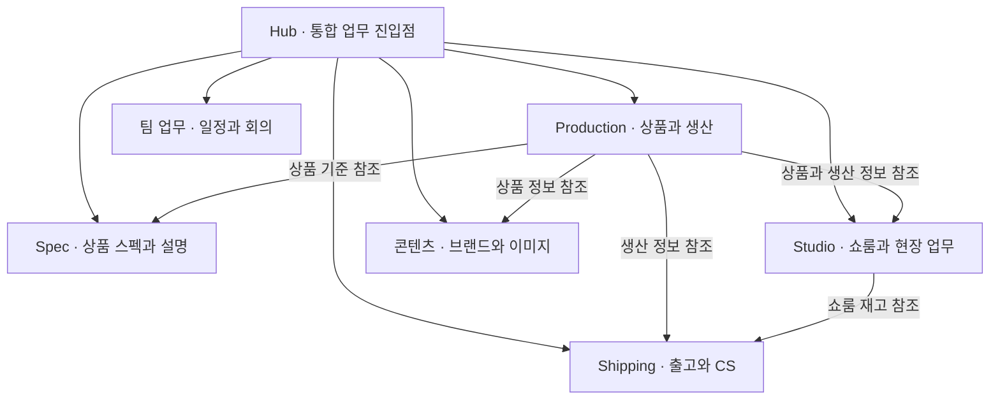

# MasterMind — 시스템 구조 안내

FUNFLEX Korea의 브랜드 운영 업무를 연결하는 내부 시스템의 구조 안내입니다.
상품 기획과 생산, 콘텐츠, 재고, 출고, 팀 업무를 하나의 업무 기반으로 연결합니다.

이 저장소에는 구조를 설명하기 위해 새로 작성한 문서만 있습니다. 운영 코드, 운영 데이터, 내부 저장소의 Git 이력은 포함하지 않습니다.

## 구성 한눈에 보기

위 도식은 주요 업무 관계를 단순화한 설명입니다. 실제 배포 상태나 모든 데이터 연결을 나타내는 실행 명세는 아닙니다.

## 안내 문서

- [주요 폴더와 앱의 역할](docs/structure.md)
- [업무 흐름과 데이터 소유 관계](docs/workflows.md)
- [공개 범위](docs/public-scope.md)

## 기본 기술 구성

- TypeScript와 Bun을 중심으로 구성한 업무별 웹앱
- SQLite를 사용하는 서비스별 데이터 관리
- 중앙 Hub를 통한 업무 진입과 공통 탐색
- 공유 UI 구성요소와 디자인 기준
- 문서와 작업 인계를 통한 업무 맥락 연결

## 열람 범위

가격·단가·원가·급여·매출·손익·예산·정산 등 금액 관련 데이터는 제공하지 않습니다.
개인정보, 거래처 자료, 계약서, 실제 주문과 재고 기록, 계정과 접속정보도 제공하지 않습니다.
이 공개 안내에서 내부 운영 시스템이나 비공개 자료에 접근할 수 없습니다.

구조 확인 기준: 2026-10-06. 내부 구조가 변경되더라도 이 공개본은 자동으로 동기화되지 않습니다.
