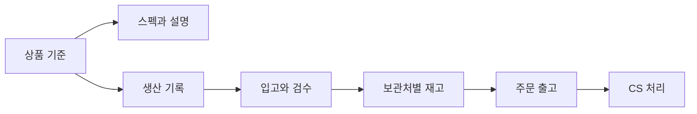

# 업무 흐름과 데이터 소유 관계

## 상품과 생산

상품과 옵션의 공통 기준은 Production에서 관리합니다.
생산 업무는 차수와 이벤트를 중심으로 기록하며, 다른 앱은 필요한 상품·생산 정보를 참조합니다.
상품 스펙과 설명은 Spec, 생산 지시 문서는 Workorder에서 다룹니다.

## 재고와 출고

생산의 누적입고와 보관처의 현재고는 서로 다른 개념입니다.
쇼룸 실사와 현장 재고 업무는 Studio, 물류 재고와 주문 출고 업무는 Shipping에서 다룹니다.
연결된 화면은 원본을 참조하며 별도의 중복 상품 마스터를 만들지 않는 방향으로 구성합니다.

이 흐름은 업무를 이해하기 위한 개념도입니다. 모든 단계의 자동 연동이나 완료 상태를 보증하지 않습니다.

## 콘텐츠와 팀 업무

상품 정보와 이미지 자료는 상품 설명, 콘텐츠 제작과 자사몰 작업에 연결합니다.
일정과 회의 기능은 업무 진행을 연결하고, 내부 문서에는 결정과 작업 인계를 남깁니다.

## 데이터 소유 관계

| 영역 | 기준 역할 |
|---|---|
| 상품·옵션·생산 기록 | Production |
| 상품 스펙·설명 | Spec |
| 쇼룸 실사·현장 재고 업무 | Studio |
| 물류 재고·주문 출고·CS | Shipping |
| 일정 표시와 관리 | Calendar |
| 회의와 후속 실행 관리 | Meeting |

금액 필드, 실제 데이터 행, 내부 테이블 정의와 조회 API는 이 공개본에 포함하지 않습니다.
